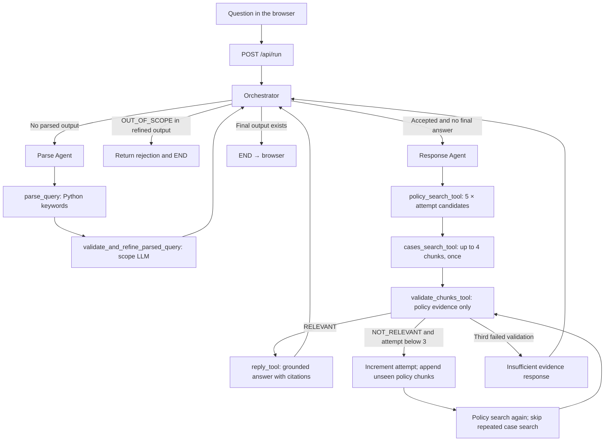

# multi-agent-rag-eval-observability

**TenantFlow — evidence-grounded answers with runtime evaluation and LangSmith observability.**

**Repository:** [Namees-aLbayati/multi-agent-rag-eval-observability](https://github.com/Namees-aLbayati/multi-agent-rag-eval-observability)

A local full-stack learning app that turns a rental question into a visible journey through **scope parsing → policy retrieval → supporting cases → evidence validation → a cited answer**. A FastAPI backend runs a real three-node LangGraph; a browser frontend streams each step, displays tool inputs and outputs, and lets you inspect retrieved passages. Optional LangSmith tracing exposes the same run across nodes, tools, and model calls.

## Understand the workflow first



Only **Orchestrator**, **Parse Agent**, and **Response Agent** are LangGraph nodes. The tools execute inside those nodes. The roadmap in the UI presents “Respond” as an explanatory phase, not a fourth node.

### What `.invoke()` does at each level

1. `graph.compile().invoke(initial_state)` starts the whole graph. Its entry point is the orchestrator.
2. The parse node calls `parse_query.invoke(...)` to execute keyword rules. The `@tool` decorator supplies that method; no model is involved in keyword parsing.
3. A validation model checks both the original question and keyword output. Its refined result determines scope, so it can correct a keyword rejection.
4. The response node combines `user_query + "\n\n" + refined_output` into the retrieval query.
5. A tool-bound model returns a tool request containing `name`, `args`, and `id`. **It does not execute the Python function.** Python dispatches by name and supplies authoritative arguments from state.
6. The tool result updates shared state and is appended as a `ToolMessage` linked to the request ID. The next model call sees the accumulated conversation.
7. The reply tool makes a separate model call using the original question and retrieved evidence. It sets `final_output`, returns from the response node, and the orchestrator routes to END.

### Tool inputs, operations, and outputs

| Tool | Inputs | Operation | Output / saved state |
|---|---|---|---|
| `parse_query` | Original question | Keyword classification | `parsed_output` |
| `validate_and_refine_parsed_query` | Question + initial parse | Structured model scope check | `refined_output` or `OUT_OF_SCOPE` |
| `policy_search_tool` | Combined query, attempt, seen chunk IDs | Chroma similarity search; filter seen IDs; return up to 5 new chunks | Append to `legal_chunks`; extend `seen_legal_ids` |
| `cases_search_tool` | Combined query | Chroma search for up to 4 chunks | `case_chunks`; may contain multiple cases |
| `validate_chunks_tool` | Original question, policy chunks, attempt | Structured model sufficiency check | `validation_status` and explanation |
| `reply_tool` | Original question, policy chunks, case chunks | Write from supplied evidence with filename/page citations | `final_output` |

### Retries are iteration, not Python recursion

The response node uses a bounded loop. A NOT_RELEVANT validation increments `retrieval_attempt`: **1 → 2 → 3**. The next policy search requests **5 → 10 → 15** candidates using the same combined query. Up to five unseen chunks are appended each time; existing evidence is retained. Cases are searched once. Three failed validations end with insufficient evidence. No internet search is performed.

### Intentional improvements over the notebook

- Tool order is enforced in Python. Each live routing call exposes only the next allowed tool, forces that tool choice, and disables parallel calls. The model still returns a tool request and Python executes it, but the model cannot reorder this workflow.
- Tool arguments come from state, preserving the notebook's dispatch pattern. The UI shows requested and executed arguments separately.
- A hard step bound prevents an endless model/tool loop. Plain model text cannot bypass the reply tool.
- Deduplication uses unique **chunk IDs**, not filename-plus-page IDs, so different chunks on the same page remain retrievable.
- Validation checks **policy evidence only**. Case text cannot compensate for missing primary evidence.
- Chroma stores text, metadata, and embeddings. Index fingerprints include PDF contents, splitter settings, embedding model, and endpoint; matching indexes are reused. Changed inputs produce a new local index.
- The parser is a compact adaptation of the notebook's keyword rules; it is deliberately basic. The scope LLM can correct its mistakes in live mode.

## Run locally

Requires Python **3.11–3.13**. No Node.js build or external database service is needed.

```bash
cd multi-agent-rag-eval-observability
python3 -m venv .venv
source .venv/bin/activate
python -m pip install -r requirements.txt
cp .env.example .env
./run.sh
```

Open **http://127.0.0.1:8000**. Start with **Demo walkthrough**, which needs no credentials. The demo executes the real LangGraph and Python tool dispatch, but model requests, evidence, validation outcomes, and the final reply are explicit fixtures. It is not an answer based on your PDFs. Select the retry checkbox to watch attempt 1 fail and attempt 2 pass. Try the out-of-scope example to see early termination.

For this existing notebook workspace, `run.sh` also recognizes the already-installed `../.venv` environment. From `w2`, run:

```bash
cd tenantflow-langgraph
./run.sh
```

Use `PORT=8001 ./run.sh` if port 8000 is occupied. The server binds to loopback, not your network interface. Stop with Ctrl+C. This is a local learning app, without authentication or multi-user isolation; do not expose it directly to the internet.

## Enable real PDF answers

1. Put `tenants_rights.pdf` and `previous_judgements.pdf` in `data/`. The initial local setup includes copies of your existing PDFs; Git ignores them.
2. Set `OPENAI_API_KEY` in `.env`. Optional `OPENAI_BASE_URL` supports a compatible endpoint; it must support chat tool calling, structured outputs, and embeddings. You may need to choose models supported by that provider.
3. Restart the server after configuration changes.
4. Click **Build / reuse PDF index**. New indexing sends extracted PDF text to the configured embedding API and incurs provider charges. Matching stored indexes are reused.
5. Select **Live PDF mode** and run a question.

For migration only, when the app remains beside the notebook it can read `../config.json` as a fallback for missing key, base URL, and LangSmith credentials/project. Environment settings take precedence. It does not copy or return secrets. Standalone clones should use `.env`.

The answer is limited to the supplied PDFs. It does not establish that the documents are current, comprehensive, or applicable to your jurisdiction. Case retrieval returns chunks, not a guaranteed single case. Similarity distances are ranking measurements, not confidence scores. Retrieved snippets are shown for inspection; citations produced by a model still need review.

## Observe live runs in LangSmith

Set these in `.env`, then restart:

```dotenv
LANGSMITH_TRACING=true
LANGSMITH_API_KEY=your_langsmith_key
LANGSMITH_PROJECT=tenantflow-langgraph
```

If your key requires an explicit workspace, set `LANGSMITH_WORKSPACE_ID`. Use `LANGSMITH_ENDPOINT` for the appropriate deployment/region. Create keys and inspect projects at [LangSmith](https://smith.langchain.com/).

Run a live question, then click **Open LangSmith trace** when available, or find `tenantflow_request` in your project. Expand it to see graph/node execution, tool inputs/outputs, tool-selection model calls, scope/evidence model calls, answer generation, timings, and available token usage. The browser journal is a separate local event stream; it works without LangSmith. Demo mode explicitly disables external tracing.

Tracing is opt-in because it sends questions, retrieved document excerpts, prompts, and outputs to LangSmith. API credentials remain server-side. Use content you are permitted to send to your configured providers. Traces are uploaded asynchronously; a returned trace link does not by itself prove remote ingestion succeeded. Check the LangSmith dashboard and server log for connectivity/authentication issues.

Official references: [LangGraph StateGraph](https://reference.langchain.com/python/langgraph/graph/state/StateGraph), [LangSmith tracing](https://docs.langchain.com/langsmith/annotate-code).

## Full-stack structure

```text
frontend/           HTML, CSS, JS; streaming journal and source inspector
backend/main.py     FastAPI routes, background worker, NDJSON stream
backend/workflow.py Three-node graph, tools, model request/dispatch loop
backend/retrieval.py PDF splitting, embeddings, persistent Chroma collections
backend/settings.py Environment configuration and notebook migration fallback
data/               Local source PDFs (ignored)
.runtime/           Persistent generated indexes (ignored)
tests/              Deterministic workflow and HTTP integration tests
```

The browser POSTs to `/api/run`. A background thread runs the graph and pushes events into a queue. FastAPI streams newline-delimited JSON; the frontend renders events as they arrive. The terminal result includes the answer, retrieved chunks, validation status, attempt count, duration, and optional trace link. **Download run JSON** exports the result and local journal. Runs are not otherwise stored as a local chat history. One index build or question runs at a time; a concurrent request receives HTTP 409. Closing the browser does not cancel a model request already underway.

## Tests

```bash
python -m pip install -r requirements-dev.txt
python -m pytest -q
```

Tests cover the successful path, out-of-scope termination, evidence accumulation and retries, third-failure termination, chunk deduplication, API streaming and validation, and safe error responses. Tests do not contact models or LangSmith. GitHub Actions runs them on Python 3.12.

## Push to GitHub

The GitHub repository is **`multi-agent-rag-eval-observability`**. To publish a fresh local copy, run from its folder:

```bash
git init
git add .
git diff --cached --stat
git commit -m "Build observable policy-first LangGraph app"
git branch -M main
git remote add origin https://github.com/Namees-aLbayati/multi-agent-rag-eval-observability.git
git push -u origin main
```

Review staged files before committing. `.env`, config files, source PDFs, generated indexes, and virtual environments are ignored. The original notebook is outside this repository; its saved outputs have not been reviewed for credentials and should not be added blindly. Choose a license before distributing code publicly.

## Troubleshooting

- **Missing kernel is irrelevant here:** this app runs as a Python web server, independently of Jupyter.
- **Live mode is unavailable:** check environment status, put both PDFs in `data/`, and build the index.
- **Provider rejects tools or JSON schemas:** confirm endpoint support and model names. Some notebook API gateways support only a subset of OpenAI features.
- **No trace appears:** confirm tracing is enabled, credentials/workspace/endpoint are valid, and you ran Live PDF mode. Demo never uploads traces.
- **Indexing fails:** check the terminal, embedding API permissions, and whether PDF text is extractable. Retrying upserts stable chunk IDs instead of duplicating records.
- **No sufficient evidence:** this is an expected outcome. Add a suitable document or clarify the question; the app must not invent missing policy.
- **Folder name contains `:`:** Python refuses to create a local venv in such a path. Rename the folder (for example `3-4`) first.
